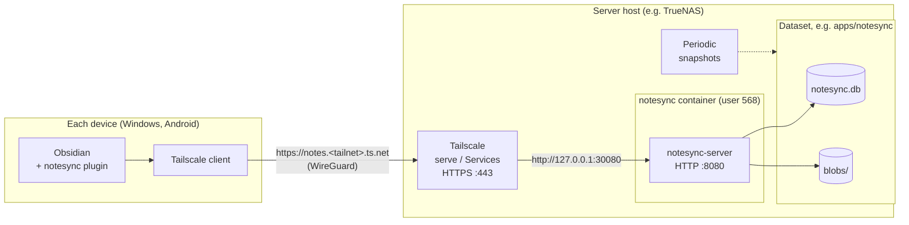

# Deploying notesync

This guide runs the server in Docker behind an HTTPS front end, then installs the plugin on
each device. Replace anything in `<angle brackets>` with your own values.



The server only listens on the host's loopback address. Tailscale (or a reverse proxy) adds
HTTPS and decides who can reach it; notesync's own accounts decide whose vaults they see.

## 1. Get the server image

Each release publishes `ghcr.io/<owner>/notesync-server:<version>` (see
[.github/workflows/release.yml](../.github/workflows/release.yml)). If the repository is
private, make the package public in GitHub (Packages > notesync-server > Package settings),
or log in to `ghcr.io` on the host first.

To build it yourself instead:

```bash
docker build -t notesync-server server
```

## 2. Run the server

1. Create a folder for its data, owned by the user the container runs as (568:568 by
   default, which matches the `apps` user on TrueNAS).
2. Start it with [deploy/compose.example.yaml](../deploy/compose.example.yaml), adapted to
   your paths. The example binds the port to `127.0.0.1` so it's reachable only through the
   HTTPS front end on the same machine.
3. Check it's up from the host:

   ```bash
   curl http://127.0.0.1:30080/api/v1/health
   ```

### On TrueNAS

1. Create a dataset such as `<pool>/apps/notesync` and give user `apps` (568) read and
   write access.
2. Apps > Discover Apps > ⋮ > **Install via YAML**, and paste the compose example with the
   image, port and `/mnt/<pool>/apps/notesync` path filled in. TrueNAS doesn't read `.env`
   files, so write the values directly instead of using `${...}`.

## 3. Put HTTPS in front

The plugin needs an `https://` address. Any of these work:

- **Tailscale Services:** `tailscale serve --service=svc:notes --https=443 http://127.0.0.1:30080`
  on a tagged host, which gives `https://notes.<tailnet>.ts.net`.
- **Tailscale Serve** on the same machine, if you don't use Services.
- **Caddy or another reverse proxy**, with a certificate for your own domain.

Serve the server at the root of its own name; it doesn't support sub-paths.

## 4. Create accounts

Open a shell in the container (on TrueNAS: Apps > notesync > Shell) and run:

```bash
notesync-server user add <name> --admin
```

It asks for the password. You can add the other users from the admin page (below) or with
`notesync-server user add <name>`. `notesync-server user list` shows them; see the main README
for the other commands.

### The admin page

Open `https://notes.<tailnet>.ts.net/admin` and sign in with an admin account. From there you
can add users, set passwords, disable accounts, grant admin rights, clear lockouts, sign out
lost devices, restore deleted vaults, see storage use and run cleanup.

- Only admin accounts can sign in. A session ends after 30 minutes without use, or 12 hours
  after signing in.
- Setting someone's password and granting admin rights ask for your own password again.
- Every action is logged with your username.
- The page is served by the same server and port as the API, so it's only reachable the
  same way the plugin is (through Tailscale or your proxy). To turn it off, set
  `NOTESYNC_ADMIN_PAGE=off`.
- It needs HTTPS (or `localhost`), because the sign-in cookie is marked secure.

## 5. Install the plugin

The plugin isn't in Obsidian's community directory. Install it on each device one of these ways.

**With BRAT (easiest, also gets updates):** install the community plugin "BRAT", then
use its **Add beta plugin** command with the repository's GitHub address. BRAT reads the
`main.js`, `manifest.json` and `styles.css` attached to the latest release. It's simplest
with a public repository; for a private one, check BRAT's documentation for token setup.

**By hand:** download `main.js`, `manifest.json` and `styles.css` from a release (or build
them with `npm run build` in `plugin/`), and copy them into
`<vault>/.obsidian/plugins/notesync/`. On Android, the vault is usually in
`Documents/<vault name>`. Use a file manager or a USB cable, and show hidden folders to see
`.obsidian`. Then restart Obsidian and turn the plugin on in Settings > Community plugins.

The plugin needs Obsidian 1.11.4 or newer.

## 6. Connect each device

1. Settings > notesync: enter the server URL (for example `https://notes.<tailnet>.ts.net`),
   your username and password, then **Sign in**. The password is used once and isn't saved;
   the device's token goes in Obsidian's secret storage.
2. **Choose a vault** or create one. On the first device, create a new server vault. On
   other devices, choose the same one.
3. Confirm the first sync. It combines both sides and never deletes anything: files with the
   same path and different contents keep the server version, plus a conflict copy.

**Tip for the second device:** start from an empty vault and let the first sync download
everything. That avoids conflict copies for files that differ only slightly.

## Backups

Back up the data folder: `notesync.db` and `blobs/`. Stop the container first, or take a
filesystem snapshot (on TrueNAS, a periodic snapshot of the dataset). Each device's vault is
also a full copy of the notes.

## Limits and maintenance

**Limits**

| What | Limit |
|---|---|
| One file | `NOTESYNC_MAX_FILE_MB`, 100 MB by default. Larger files are skipped by the plugin and listed in its last-sync report. Uploads that large also need the HTTPS front end to allow them. |
| Total storage | None built in, and no per-user quota. The dataset's free space is the limit. |
| Users, vaults, devices | No fixed limit. |
| Sign-in attempts | 10 per username, then one every 5 seconds. 10 *wrong* passwords within 15 minutes lock the username for 15 minutes (`user unlock` clears it). |
| Syncs | 10 per device, then one every 5 seconds. Normal use is far below this. |
| Other requests | 600 per device, then 20 per second. A large first sync is slowed down, not refused. |
| Sign-in lifetime | A device that doesn't sync for `NOTESYNC_TOKEN_DAYS` (30) must sign in again. Devices that sync renew it about once a day. |

All of these are environment variables; see the [README](../README.md#configuration).

**Storage use.** Every version of every file stays on the server for `NOTESYNC_HISTORY_DAYS`
(30 by default) after it's replaced or deleted. A vault that changes a lot can therefore use
noticeably more space than its current size, especially with large attachments that change.
Lower the history period to save space, or raise it to keep more history.

**What the server does by itself**
- Once a day: removes file versions and deleted files older than the history period, uploads
  that were never used, and vaults deleted more than the history period ago. Run it any time
  with `notesync-server gc`.
- On start: applies database updates.

**What it doesn't do**
- Back itself up: see [Backups](#backups).
- Shrink the database file: SQLite reuses freed space instead. The database holds only
  accounts and the list of changes, so it stays small (a few MB for tens of thousands of
  changes); file contents live in `blobs/`.
- Trim the list of changes: it's kept forever, which is what lets every device catch up
  however long it's been offline.

**How many users.** Not load-tested yet; these are estimates from the design. A device checks
in every few minutes and after edits, so dozens of users with several devices each is light
work, and a few hundred light users should be fine. The database accepts one commit at a time
across all vaults; commits are short, so that only matters with many devices saving at the
same moment. Disk space and upload speed for large files are the practical limits. It isn't
designed for an organization with thousands of users.

**Things to check now and then**
- Free space on the dataset, and the size of `blobs/`.
- That snapshots are being taken.
- The server logs for repeated errors, `failed sign-in` and `account locked` lines.
- `notesync-server user list` (or the admin page) for lockouts and for accounts that should
  be disabled.

**If a device is lost or a token may have leaked:** sign that device out from another
device or from the admin page, or reset the password with `notesync-server user passwd <name>`, which signs out
every device. An unused token stops working by itself after `NOTESYNC_TOKEN_DAYS`.

**If a vault was deleted by mistake:** restore it from the user's page in the admin page,
or use the command line: `notesync-server vault list --user <name> --deleted` shows it and how many days are left, and `notesync-server vault restore --user <name> <id>`
brings it back.

## Updating

1. Update the server image tag and redeploy. Database changes run automatically on start.
2. Update the plugin on each device, through BRAT or by copying the new files. Obsidian only
   loads the new code after a restart: close and reopen it, or run **Reload app without
   saving** from the command palette.

The server rejects plugin versions older than it supports, with a message asking you to
update the plugin. The minimum only goes up when the protocol changes or an old plugin has a
security problem; the changelog says when. **Update the server first, then the plugin on
each device:** a newer plugin works with the same server version, but an older plugin may be
refused by a newer server.

**Upgrading to 0.2.0:** 0.2.0 servers refuse 0.1.x plugins (they don't check the paths the
server sends, and can't renew their sign-in), so update every device's plugin right after
the server. Devices stay signed in: existing sign-ins get 30 days from the upgrade and then
renew themselves.

**Upgrading to 0.3.0:** adds the admin page. 0.2.0 plugins keep working, so the plugin
update can wait. The database change (a table for admin page sign-ins) runs on start.

**Check which versions are running**
- **Plugin:** Settings > notesync > Status shows "Plugin version x.y.z", the build Obsidian
  actually loaded. Settings > Community plugins shows it too.
- **Server:** `https://notes.<tailnet>.ts.net/api/v1/health` returns its version.

Every change to the plugin or server gets a new version number (see
[CHANGELOG.md](../CHANGELOG.md)), so this tells you whether a fix has reached a device.
