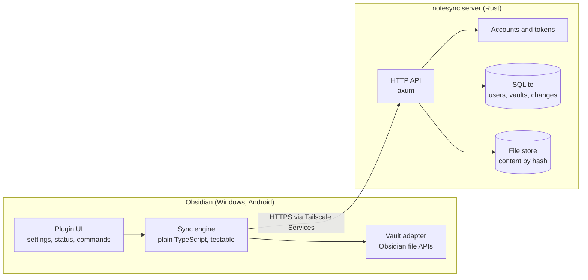
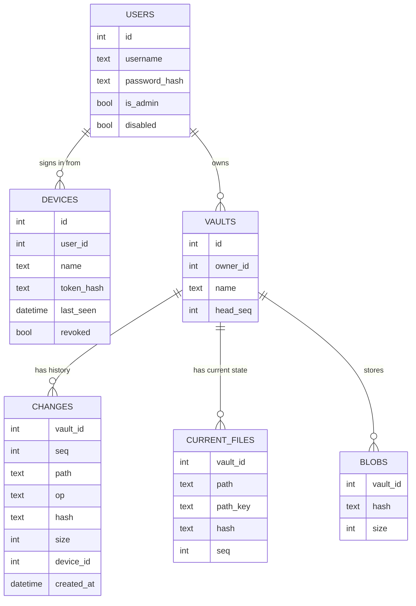
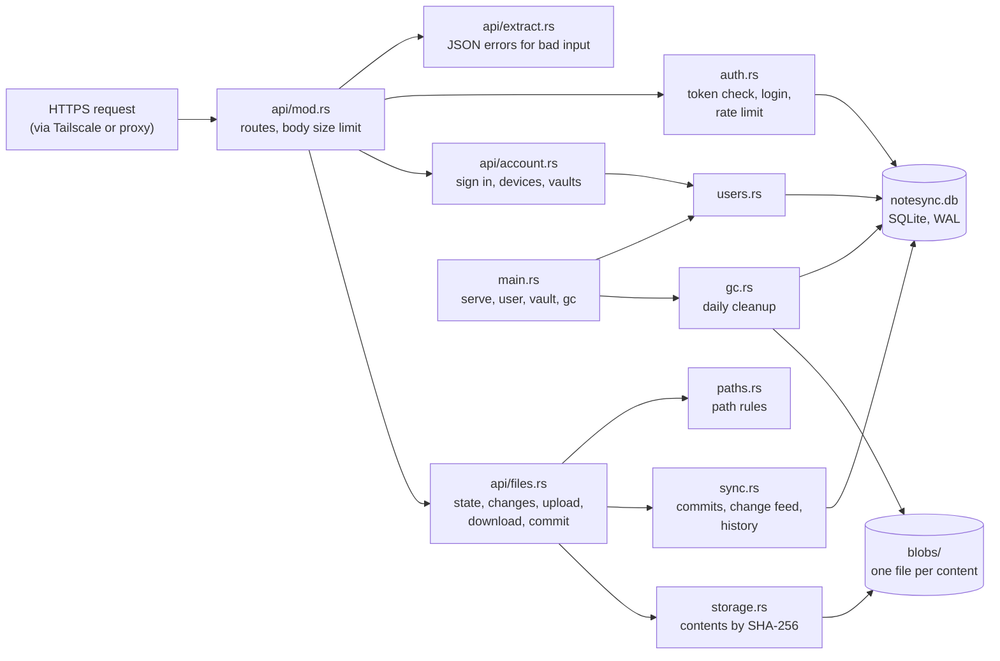
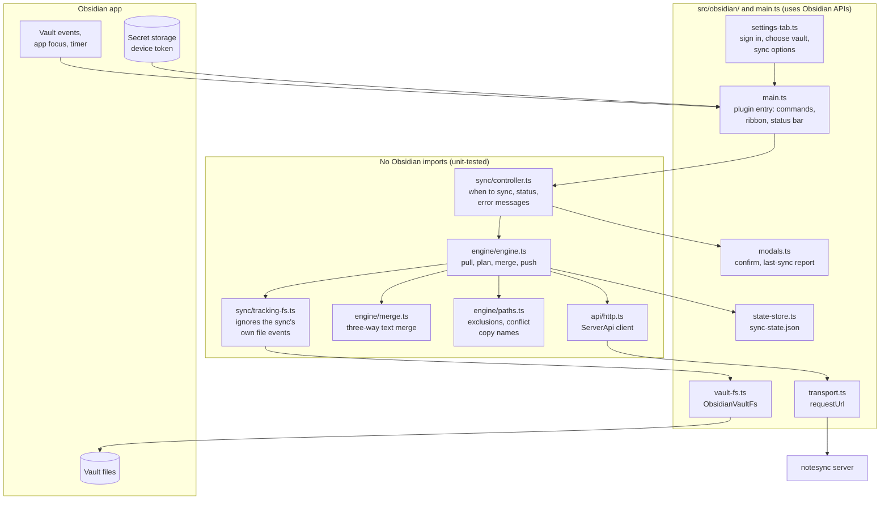
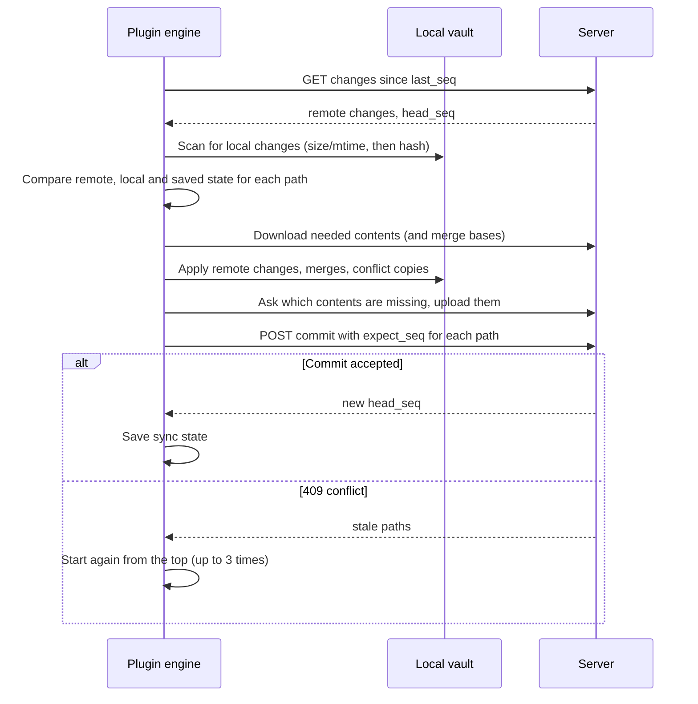

# notesync: server and plugin design (v1)

A self-hosted sync service for Obsidian vaults: a **Rust server** you run yourself (for example on a NAS, reached through Tailscale), and an **Obsidian plugin** for desktop and mobile.

`notesync` is a working name; see [Defaults](#defaults).

## Decisions so far

| Topic | Decision |
|---|---|
| What syncs | Notes and attachments only. Settings and plugins (`.obsidian/`) are not synced in v1 |
| Accounts | User accounts on the server, created by an admin; multiple users per server |
| Vaults | Each user can have **multiple private vaults**; no sharing between users in v1 |
| Conflicts | Merge Markdown automatically when edits don't overlap; otherwise keep a conflict copy. Non-text files always get a conflict copy |
| Encryption | Not in v1, but the design keeps it possible (see [Future encryption](#future-encryption)) |
| Platforms | Windows (desktop) and Android, one plugin |
| Repo | Two main folders: `server/` and `plugin/` |
| Tests | Automated tests for server internals and API, plus plugin sync tests |

## Architecture



**Responsibilities**
- **The server is simple and strict.** It stores file contents and the change history, checks logins, keeps users' data separate, and rejects stale writes. It never reads or merges note contents.
- **The plugin does the thinking.** It detects local changes, decides what to upload and download, and merges conflicts. Keeping merging on the device is what makes end-to-end encryption possible later.

## Server

### Tech stack
- **Language and web:** Rust, `tokio`, `axum`, `tower-http` (request limits, tracing).
- **Database:** SQLite via `sqlx`, with migrations in `server/migrations/`.
- **Security:** `argon2` (passwords), `sha2` (content hashes and token hashes), `rand` (tokens).
- **Other:** `serde` / `serde_json`, `clap` (command line), `tracing` (logs).
- **Shape:** a single binary with subcommands:
  - `notesync-server serve` runs the server.
  - `notesync-server user add|passwd|disable|enable|list|make-admin` manages accounts.
  - `notesync-server vault list --user <name>` lists a user's vaults.
  - `notesync-server gc` cleans up old data (also runs daily on its own).

### Configuration (environment variables)

| Variable | Default | Purpose |
|---|---|---|
| `NOTESYNC_BIND_ADDR` | `127.0.0.1:8080` | Listen address |
| `NOTESYNC_DATA_DIR` | `./data` | Holds `notesync.db` and `blobs/` |
| `NOTESYNC_MAX_FILE_MB` | `100` | Largest file accepted |
| `NOTESYNC_HISTORY_DAYS` | `30` | How long old versions and deleted files are kept |
| `NOTESYNC_LOG` | `info` | Log level |

### Data model



- **`changes`** is the vault's history. Every upload or delete adds a row with the next sequence number (`seq`) for that vault, and these numbers are what "changes since N" uses.
- **`current_files`** is the latest state of each path; it's a fast lookup kept in step with `changes`. `path_key` is the lower-cased path, used to block two paths that differ only by letter case.
- **`blobs`** records file contents stored on disk at `blobs/<vault_id>/<first 2 hex chars>/<sha256>`. Contents are **stored per vault**, never shared across users, so one user can't probe for another's files.
- **Deletes are recorded, not erased:** a delete is a `changes` row with `op = delete`. The old contents stay until history expires.

### API (`/api/v1`, JSON)

Every request except login and health checks needs `Authorization: Bearer <token>`. Vault routes return **404 for vaults you don't own**, so the server doesn't reveal that they exist.

| Method and path | Purpose |
|---|---|
| `GET /health` | Health check, no login |
| `POST /auth/login` | `{username, password, device_name}` returns `{token, device_id}` |
| `POST /auth/logout` | Revokes the current device token |
| `GET /me` | Current user |
| `PUT /me/password` | Change password; optionally sign out other devices |
| `GET /me/devices` | List signed-in devices |
| `DELETE /me/devices/{id}` | Sign out a device |
| `GET /vaults` | List your vaults |
| `POST /vaults` | `{name}` creates a vault |
| `PATCH /vaults/{id}` | Rename a vault |
| `DELETE /vaults/{id}` | Delete a vault (kept for the history period, then removed) |
| `GET /vaults/{id}/state` | Current files and `head_seq`, used for a first sync |
| `GET /vaults/{id}/changes?since=N&limit=500` | Changes after `N`, with `{changes, head_seq, more}` |
| `POST /vaults/{id}/blobs/missing` | `{hashes:[...]}` returns the ones the server doesn't have |
| `PUT /vaults/{id}/blobs/{sha256}` | Upload contents; the server checks the hash and size |
| `GET /vaults/{id}/blobs/{sha256}` | Download contents |
| `POST /vaults/{id}/commit` | Apply a batch of changes all at once or not at all (below) |
| `GET /vaults/{id}/history?path=...` | Past versions of one file |

Admin endpoints for accounts can come later; v1 uses the command line.

**Errors** use one format: `{"error": {"code": "conflict", "message": "..."}}`. Codes include `unauthorized`, `not_found`, `conflict`, `case_conflict`, `invalid_path`, `hash_mismatch`, `too_large`, `rate_limited` and `client_too_old`.

**Version check:** the plugin sends `X-Notesync-Client: <version>`, and the server rejects versions older than it supports with `client_too_old`.

### The commit operation

This is the heart of the system:

```json
POST /vaults/7/commit
{
  "changes": [
    {"path": "Daily/2026-11-06.md", "op": "upsert", "hash": "ab12...", "expect_seq": 41},
    {"path": "Ideas.md", "op": "upsert", "hash": "cd34...", "expect_seq": null},
    {"path": "Old.md", "op": "delete", "expect_seq": 12}
  ]
}
```

- **`expect_seq`** is the version of that path the device last saw; `null` means "this path should not exist yet."
- **Checks:** in one database transaction, the server confirms that every path is still at the expected version, every uploaded hash exists, and every path is valid.
- **If everything passes:** each change gets the next `seq`, and the server returns `{head_seq, applied:[{path, seq}]}`.
- **If anything fails:** nothing is applied. A stale path returns **409** with `{conflicts:[{path, current_hash, current_seq}]}`, and the plugin pulls, merges and tries again.
- **Per-path checks** mean edits to different notes never conflict, even when two devices sync at the same moment.

### Path rules (checked by the server)
- Relative paths with `/` separators, Unicode-normalized (NFC), at most 1,024 bytes.
- Not allowed: `..` segments, leading `/`, control characters, and `< > : " | ? * \`. Segments can't end in a space or dot, since Windows can't store those.
- A path that matches an existing path apart from letter case is rejected with `case_conflict`.

### Security
- **Passwords:** hashed with Argon2id. Failed logins are rate-limited per username (10 per 15 minutes). There's no per-IP limit: behind Tailscale Serve or a local reverse proxy, every request comes from the same local address.
- **Tokens:** random 256-bit device tokens, stored only as hashes. They don't expire but can be revoked per device. Disabling a user revokes all their tokens.
- **Isolation:** every vault query is limited to the signed-in user, with tests for it.
- **Size limits:** request bodies are capped (file limit plus some headroom).
- **Logs** never include tokens, passwords or note contents.

### Server modules



### Cleanup and history
- File contents stay available for `NOTESYNC_HISTORY_DAYS` after a newer version or a delete replaces them. This allows "restore an old version" and recovery from a bad sync.
- `gc` removes stored contents that no current file uses and that are older than the history period, uploads that were never committed, and vaults deleted more than the history period ago. It runs once a day while the server is running, and on demand with `notesync-server gc`.
- In v1, `changes` rows are kept forever (they're small); the history endpoint marks versions whose contents were removed as unavailable.
- SQLite doesn't shrink its file after deletes; it reuses the free space. At notesync's database sizes that doesn't matter, so the server doesn't run `VACUUM`.

## Plugin

### Structure



- **`engine/`:** the sync logic, in plain TypeScript with **no Obsidian imports**. It talks to three small interfaces (`engine/types.ts`):
  - `VaultFs`: list, read, write, trash, rename and stat files.
  - `ServerApi`: the HTTP calls above.
  - `StateStore`: loads and saves the device's sync record.

  Tests use in-memory versions of all three. The real plugin uses Obsidian's file APIs, `requestUrl` and a JSON file in the plugin folder.
- **`engine/merge.ts`:** line-based three-way merge for text.
- **`sync/`:** the controller decides when to sync (startup, after edits, timer, returning to the app, manual), keeps the status and turns errors into messages. `TrackingFs` records which files the sync itself changed, so those file events don't start another sync.
- **`obsidian/` and `main.ts`:** the Obsidian-specific glue: plugin entry point, settings screen, commands, ribbon icon, status display, dialogs and event hooks.

### Platform rules (Windows and Android)
- `manifest.json` sets `"isDesktopOnly": false`.
- Use only Obsidian's APIs: `app.vault` / `vault.adapter` for files, `requestUrl` for HTTP, and Web Crypto (`crypto.subtle.digest('SHA-256')`) for hashes. No Node.js modules.
- **SHA-256 instead of BLAKE3:** Web Crypto has SHA-256 built in on both platforms, so the plugin needs no extra hashing library.
- Android pauses Obsidian in the background, so sync runs on open, after edits, on a timer and on demand, never as a background service.
- Show status in the status bar on desktop. Mobile has no status bar, so use a ribbon icon state and notices there.

### Settings
- **Server URL**, e.g. `https://notes.<tailnet>.ts.net`.
- **Sign in:** username and password are sent once to get a device token, and **the password is never saved**.
- **Token storage:** kept in Obsidian's secret storage (`app.secretStorage`, Obsidian 1.11.4+), never in the plugin's data file.
- **Remote vault:** pick an existing vault or create one.
- **Sync triggers:** on startup (on by default), after edits (wait 10 seconds after the last change), every N minutes (default 5) and manually.
- **Excluded paths:** `.obsidian/`, `.trash/` and `.git/` are always excluded. Users can add patterns.
- **Maximum file size:** the plugin skips larger files and reports them.
- **Mass-delete limit:** pause and ask if one sync would delete more than 25 files or 10% of the vault.

### Saved sync state (per device, per vault)
Kept in `sync-state.json` in the plugin's folder, saved safely (write a temporary file, then replace):
- `vault_id` and `last_seq`.
- For each path: `{hash, seq, mtime, size}`, the state at the last successful sync.

This record lets the plugin tell "I deleted this" from "the server added this." The base version needed for merging is downloaded from the server by its hash, so the device doesn't store extra copies.

### Sync cycle



Only one sync runs at a time. A sync that starts while another is running is queued, not run in parallel.

### Deciding what to do with each path

| Local since last sync | Server since last sync | Action |
|---|---|---|
| Unchanged | Changed | Download and write |
| Unchanged | Deleted | Move the local file to Obsidian's trash |
| Changed or new | Unchanged | Upload |
| Deleted | Unchanged | Commit a delete |
| Changed | Changed, same contents | Nothing to do; update the saved state |
| Changed | Changed, different contents | **Merge** (below) |
| Changed | Deleted | Keep the edit: upload it again (edits win over deletes) |
| Deleted | Changed | Keep the edit: download it again |
| New | New, different contents | Treat as a conflict with an empty base, which gives a conflict copy |

**Merging:**
1. **Markdown and plain text** (`.md`, `.txt`): download the base version (the last synced hash), then merge base, local and server versions.
   - **Clean merge:** write the merged text locally and upload it.
   - **Overlapping edits:** keep the **server version** in the original file. Save the **local version** as `Note (conflict 2026-11-06 1432 Pixel).md`, upload both, and show a notice.
2. **Everything else** (images, PDFs, `.canvas`, which is structured JSON where text merging is unsafe): always use a conflict copy.

No edit is ever silently dropped.

**Renames:** Obsidian reports a rename. The plugin commits it as a delete plus an upload of the same contents in **one commit**, so nothing is uploaded again. A device that receives a delete and an add with matching contents performs a rename locally, which keeps links and open tabs intact.

**Safety checks while writing:**
- Before overwriting a local file, the plugin re-checks its hash. If you edited it since the scan, the write is skipped and the next sync handles it.
- Local deletes go to Obsidian's trash (`.trash/`), never straight to permanent deletion.
- Interrupted syncs are safe to rerun. The saved state only advances after a successful commit, and downloads and uploads can be repeated without harm.

### First sync on a device
When connecting a vault that already has files, the user chooses:
- **Upload:** the server vault is new and empty, so upload everything.
- **Download:** the local vault is empty, so download everything.
- **Combine:** both have files. Matching files are linked, and differing files get conflict copies, never overwrites.

## Repository layout

```
notesync/
├── server/
│   ├── Cargo.toml
│   ├── migrations/            # SQLite schema migrations
│   ├── src/
│   │   ├── main.rs            # command line: serve, user, vault, gc
│   │   ├── config.rs
│   │   ├── api/               # routes, request/response types, errors
│   │   ├── auth/              # passwords, tokens, rate limits
│   │   ├── db/                # queries
│   │   ├── storage/           # file contents on disk
│   │   └── sync/              # commit rules, path rules, cleanup
│   ├── tests/                 # API tests
│   └── Dockerfile
├── plugin/
│   ├── manifest.json
│   ├── package.json
│   ├── esbuild.config.mjs
│   ├── src/
│   │   ├── main.ts
│   │   ├── engine/            # sync logic, no Obsidian imports
│   │   ├── merge/
│   │   ├── api/               # ServerApi over requestUrl
│   │   └── obsidian/          # VaultFs, settings, UI
│   └── tests/
├── docs/                      # this design, API reference, deployment guide
├── deploy/                    # example compose file, .env.example (placeholders only)
├── .github/workflows/ci.yml
├── LICENSE
└── README.md
```

`docs/`, `deploy/` and `.github/` are small supporting folders; the code lives only in `server/` and `plugin/`.

## Automated tests

### Server: internals (unit tests in `src/`)
- **Path rules:** valid and invalid paths, Unicode normalization, Windows-reserved characters, letter-case collisions.
- **Commit rules:** stale `expect_seq` is rejected; a batch with one bad change applies nothing; each change gets the next sequence number.
- **Accounts:** password hashing and checking; token creation and hashing; rate-limit counters.
- **Storage:** a hash mismatch is rejected, an oversized upload is rejected, and contents are stored at the right path.
- **Cleanup:** removes only contents that are unused and older than the history period.

### Server: API (integration tests in `server/tests/`)
Each test starts the app with a temporary SQLite file and a temporary folder, then calls it in-process. That's fast and needs no network.

| Area | Example tests |
|---|---|
| Login | Correct and wrong password; disabled user; revoked token; rate limit kicks in |
| Isolation | User B gets 404 for every route on user A's vault |
| Vaults | Create, list, rename, delete; duplicate names per user are rejected |
| Uploads | Upload and download round-trip; hash mismatch; too large; "missing" check |
| Commit | Success; 409 on stale version; all-or-nothing; delete; rename as one commit; `case_conflict` |
| Changes | Pagination with `since` and `limit`; `head_seq` is correct |
| History | Old versions listed and downloadable during the history period |

### Plugin
- **Engine unit tests (`vitest`):** cover every row of the table above, using an in-memory vault and a fake server.
- **Merge tests:** clean merges, overlapping edits, line endings (Windows `\r\n` vs `\n`) and empty bases.
- **End-to-end tests:** CI builds and starts the **real server**, then runs **two simulated devices** with in-memory vaults. They cover offline edits on both sides, rename vs edit, delete vs edit, interrupted syncs and the mass-delete pause, and confirm both devices end up identical.
- **Manual checklist:** for real Obsidian on Windows and Android before each release.

### CI (GitHub Actions)
- **Server:** `cargo fmt --check`, `cargo clippy -- -D warnings`, `cargo test`.
- **Plugin:** `npm ci`, type check, lint, `vitest`, build.
- **End-to-end:** build the server, then run the two-device tests.

## Future encryption
Already kept possible in v1:
- The server treats file contents as opaque bytes and never reads them.
- Merging happens on devices.
- Paths are stored as plain strings.

Adding it later would mean:
- A per-vault key derived from a passphrase (Argon2id) and contents encrypted with XChaCha20-Poly1305, both on the device.
- Encrypted paths, which means turning off the server's path and letter-case checks for encrypted vaults.
- An `encrypted` flag on each vault.

## Milestones
1. **Server core:** accounts command line, login, vaults, uploads, commit, changes, with full tests and CI.
2. **Sync engine:** in plain TypeScript, with unit tests and two-device end-to-end tests against the real server.
3. **Obsidian plugin on Windows:** settings, sign-in, status and commands, tested on a copy of your vault.
4. **Mobile and deployment:** test on Android; deploy behind HTTPS (for example Tailscale Services).
5. **Polish:** version history and restore screen, admin pages, push updates instead of timers.
6. **Later:** end-to-end encryption, settings and plugin sync, shared vaults.

## Defaults
- **Name:** `notesync` is a placeholder. If the plugin is listed in Obsidian's community directory, avoid "Obsidian" in the name.
- **License:** MIT for both folders.
- **Maximum file size:** 100 MB.
- **History kept:** 30 days.
- **Default sync timer:** 5 minutes, plus syncing after edits and on startup.
- **Conflict copy name:** `Note (conflict YYYY-MM-DD HHMM <device>).md`.
- **Mass-delete pause:** more than 25 files or 10% of the vault.
